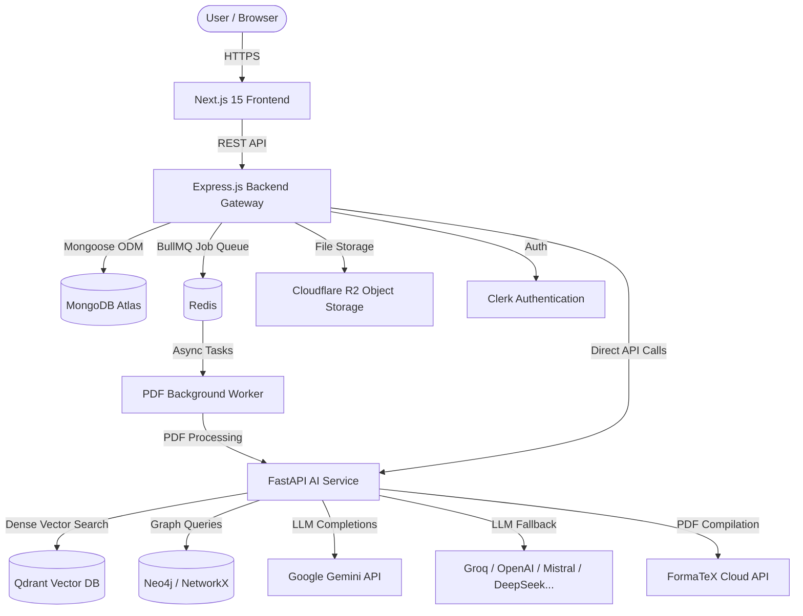
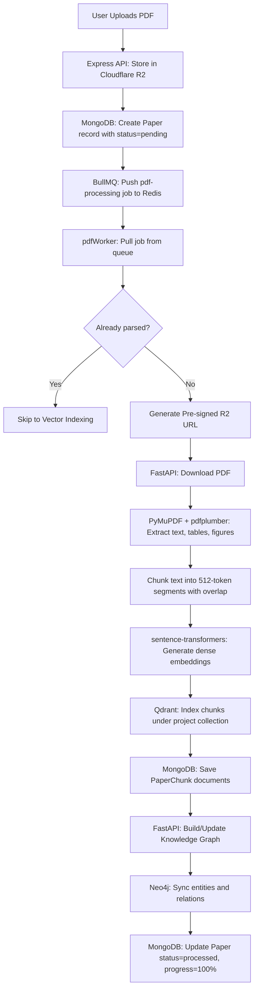
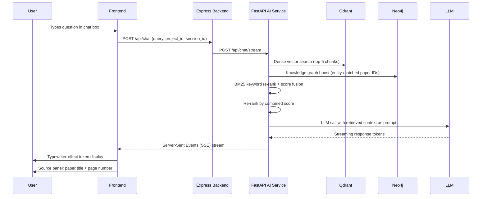
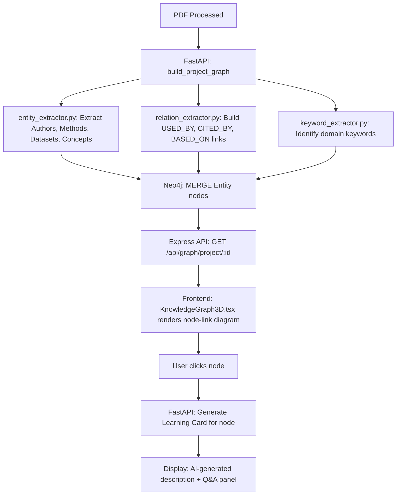
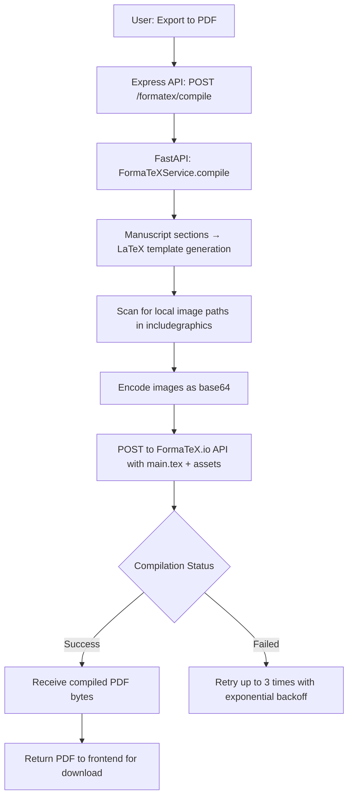
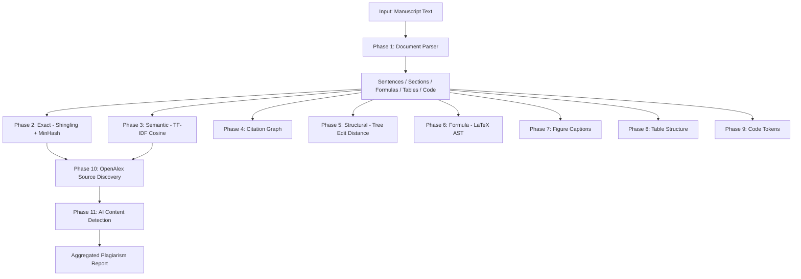

# ResearcherGPT — AI-Powered Academic Research Platform

<div align="center">

**An enterprise-grade, end-to-end academic research workspace powered by multi-agent AI, vector search, and automated scientific writing.**

*Built for PhD scholars, research labs, universities, and anyone who works seriously with scientific literature.*

</div>

---

## 📌 Table of Contents

1. [The Real-World Problem It Solves](#-the-real-world-problem-it-solves)
2. [What ResearcherGPT Does](#-what-researchergpt-does)
3. [High-Level Architecture](#-high-level-architecture)
4. [Tech Stack](#-tech-stack)
5. [Detailed Feature Workflows](#-detailed-feature-workflows)
   - [1. Project Management](#1-project-management)
   - [2. PDF Ingestion Pipeline](#2-pdf-ingestion-pipeline)
   - [3. Multi-Agent Synthesis (LangGraph)](#3-multi-agent-synthesis-langgraph)
   - [4. RAG Chat (Ask Your Papers)](#4-rag-chat-ask-your-papers)
   - [5. 3D Knowledge Graph](#5-3d-knowledge-graph)
   - [6. Literature Review Matrix](#6-literature-review-matrix)
   - [7. Open Research Gaps Board](#7-open-research-gaps-board)
   - [8. AI Writing Workspace](#8-ai-writing-workspace)
   - [9. FormaTeX — PDF Compilation Engine](#9-formatex--pdf-compilation-engine)
   - [10. Plagiarism & AI-Content Detection](#10-plagiarism--ai-content-detection)
   - [11. Paper Generator, Survey & Proposal Agents](#11-paper-generator-survey--proposal-agents)
   - [12. Peer Review Agent](#12-peer-review-agent)
   - [13. API Key Management](#13-api-key-management)
6. [Data Flow: End-to-End Walkthrough](#-data-flow-end-to-end-walkthrough)
7. [LangGraph Agent Pipeline Deep-Dive](#-langgraph-agent-pipeline-deep-dive)
8. [Hybrid RAG Retrieval System](#-hybrid-rag-retrieval-system)
9. [Plagiarism Engine — 11-Phase Detection](#-plagiarism-engine--11-phase-detection)
10. [Local Setup & Running](#-local-setup--running)
11. [Environment Variables Reference](#-environment-variables-reference)
12. [Project Directory Structure](#-project-directory-structure)
13. [Design Decisions & Interview Q&A](#-design-decisions--interview-qa)

---

## 🧩 The Real-World Problem It Solves

Academic research involves a painfully fragmented set of manual tasks that consume weeks — or even months — of a researcher's time:

| Pain Point | The Old Way | ResearcherGPT Way |
|---|---|---|
| **Literature Survey** | Read 50+ papers manually, take notes by hand | Upload all PDFs; AI synthesizes literature in minutes |
| **Finding Research Gaps** | Manually cross-read limitations sections | Gap Agent auto-extracts contradictions & open problems |
| **Writing a Manuscript** | Blank page — writer's block, inconsistent citations | Multi-agent pipeline produces a full structured draft |
| **Citations & References** | Manual APA/IEEE/MLA formatting | Citation Agent compiles all formats automatically |
| **Hallucination in AI-generated Text** | No verification step — AI makes up facts | Fact-Checker Agent validates every claim against source PDFs |
| **Plagiarism Checking** | External tools, slow uploads, word-by-word matching only | 11-phase local engine: exact, semantic, structural, formula, AI detection |
| **Knowledge Discovery** | No visual map of how papers, methods, and datasets relate | Interactive 3D knowledge graph built from paper relationships |
| **PDF Compilation** | LaTeX locally installed, complex setup | Cloud-compiled LaTeX via FormaTeX API, exported as IEEE/ACM/Springer PDFs |
| **Multi-LLM Support** | Locked to one provider, quota exhaustion crashes | Bring your own keys; fallbacks across Gemini, OpenAI, Groq, Mistral, DeepSeek, etc. |

> [!IMPORTANT]
> ResearcherGPT is **not a chatbot wrapper**. It is a full research operating system with asynchronous job queues, vector databases, graph databases, multi-agent orchestration, and a LaTeX compilation cloud — all wired together into a single, unified UI.

---

## ✨ What ResearcherGPT Does

ResearcherGPT provides the following core capabilities:

- 📄 **PDF Ingestion** — Upload academic papers; they are parsed, chunked, embedded, and indexed in a vector database automatically in the background.
- 🤖 **Multi-Agent Research Synthesis** — A sequential LangGraph pipeline of 8 specialized AI agents (Research → Literature → Methodology → Gap → Contradiction → Fact-Check → Review → Write) produces a complete academic manuscript.
- 💬 **RAG Chat** — Ask questions about your uploaded paper library; the system retrieves the most relevant chunks using a hybrid BM25 + vector + knowledge-graph retrieval strategy and answers with source citations and page numbers.
- 🕸️ **3D Knowledge Graph** — An interactive, force-directed 3D visualization connecting Papers, Authors, Methods, Datasets, and Concepts extracted from your research library.
- 📊 **Literature Review Matrix** — A comparative table extracted by AI showing each paper's model, accuracy, dataset, strengths, and weaknesses.
- 🔍 **Research Gap Board** — An AI-detected board of unsolved problems with Impact vs. Feasibility scoring that the user can curate.
- ✍️ **Writing Workspace** — A Notion-style TipTap rich-text editor with inline LaTeX math rendering, table support, and AI-assisted formatting.
- 📑 **FormaTeX PDF Export** — Converts the manuscript into a professionally compiled LaTeX PDF (IEEE, ACM, or Springer format) via cloud compilation.
- 🛡️ **Plagiarism & AI Detection** — 11-phase enterprise-grade plagiarism check covering exact matches, semantic similarity, citation graph overlap, formula comparison, structural analysis, and AI-content heuristics.
- 📝 **Survey Generator** — Generates a full systematic literature survey from your paper library.
- 📋 **Proposal Generator** — Generates a research project proposal grounded in your literature.
- 👨‍⚖️ **Peer Review Agent** — Simulates a rigorous peer review of your draft manuscript.

---

## 🏗️ High-Level Architecture

The application is built as a **decoupled three-tier system** where each layer scales independently:



### Request Lifecycle Summary

1. **User** interacts with the Next.js frontend.
2. **Frontend** sends REST calls to the Express.js Gateway on port `5000`.
3. **Gateway** handles auth (via Clerk JWT), persists state to MongoDB, and either:
   - Returns data directly for lightweight reads, or
   - Pushes a **BullMQ job** to Redis for heavy async work (PDF processing, graph generation).
4. **Background Workers** (pdfWorker, graphWorker) pull jobs from Redis and delegate to the **FastAPI AI Service** on port `8000`.
5. **FastAPI** orchestrates all AI logic: PDF parsing, vector indexing (Qdrant), knowledge graph construction (Neo4j), LangGraph multi-agent workflows, hybrid RAG retrieval, and LaTeX compilation.
6. **Progress updates** flow back to MongoDB, which the frontend polls to show real-time progress bars.

---

## 🛠️ Tech Stack

### Frontend — `client/`

| Technology | Purpose |
|---|---|
| **Next.js 15** (App Router) | React framework, SSR/CSR hybrid |
| **Tailwind CSS** | Utility-first styling |
| **Framer Motion** | Page transitions and animated states |
| **Zustand** | Lightweight reactive state management |
| **TipTap Editor** | Notion-like rich-text canvas with LaTeX math |
| **KaTeX** | Inline and block LaTeX math rendering |
| **Recharts** | Plagiarism score charts and ingestion trends |
| **Three.js / Canvas** | Interactive 3D particle knowledge graph |
| **Clerk** | User authentication, session management |

### Backend Gateway — `server/`

| Technology | Purpose |
|---|---|
| **Node.js + Express.js** | HTTP API gateway (TypeScript) |
| **MongoDB Atlas** | Document store for projects, papers, notes, citations, agent runs |
| **Mongoose** | ODM for MongoDB schema enforcement |
| **Redis + BullMQ** | Async job queue for PDF processing and graph generation |
| **Cloudflare R2** | S3-compatible object storage for uploaded PDFs |
| **Clerk SDK** | Server-side JWT auth middleware |

### AI Service Engine — `ai-service/`

| Technology | Purpose |
|---|---|
| **FastAPI (Python)** | Async HTTP API server for all AI operations |
| **LangGraph** | State-machine multi-agent workflow orchestration |
| **Qdrant** | High-performance vector database for semantic search |
| **Neo4j + NetworkX** | Graph database for knowledge graph (with in-memory fallback) |
| **sentence-transformers** | Dense embeddings for vector indexing |
| **PyMuPDF (`fitz`)** | High-speed, layout-aware PDF text extraction |
| **pdfplumber** | Table and coordinate-aware PDF parsing |
| **Google Gemini API** | Primary LLM (Gemini Flash / Pro) |
| **Groq** | High-speed fallback LLM (Llama-3.3-70B) |
| **OpenAI / Mistral / DeepSeek / Cohere / Cerebras / Kimi** | Multi-provider LLM fallback chain |
| **FormaTeX API** | Cloud LaTeX compilation to PDF |
| **OpenAlex API** | External academic database for plagiarism source discovery |

---

## 📋 Detailed Feature Workflows

### 1. Project Management

**What it is:** Every research effort is organized as an isolated **Project**. A project is the top-level container that groups all uploaded papers, generated notes, citations, agent runs, chat sessions, and manuscripts.

**Workflow:**
1. User navigates to the **Projects** page and clicks **New Project**.
2. They enter a project title and optional description.
3. The Express API creates a MongoDB `Project` document, which acts as the namespace for all subsequent operations.
4. Each project gets its own **Qdrant collection** for isolated vector search.
5. All uploaded papers, chat history, generated manuscripts, and citation lists are scoped to the project.

**Why this matters:** Isolation prevents cross-contamination between research topics (e.g., a machine learning paper project does not bleed into a healthcare policy project).

---

### 2. PDF Ingestion Pipeline

**What it is:** The core data intake mechanism. This is the most complex async pipeline in the system, involving object storage, job queuing, PDF parsing, text chunking, vector embedding, and graph construction — all running in the background while the user sees a real-time progress bar.

**Workflow (Step by Step):**



**Detailed stages tracked in real time:**

| Stage | Description |
|---|---|
| `Downloading` | Pre-signed URL generated; PDF downloaded from R2 to temp storage |
| `Parsing` | PyMuPDF extracts raw text; pdfplumber reconstructs tables and coordinates |
| `Chunking` | Text is split into overlapping ~512-token segments, preserving sentence boundaries |
| `Embedding` | sentence-transformers converts each chunk into a dense vector |
| `Vector Indexing` | Chunks and embeddings are upserted to Qdrant under the project's namespace |
| `Graph Construction` | Entities (authors, methods, datasets) are extracted and synced to Neo4j |
| `Validation` | Chunk count is validated; zero-chunk documents fail with an error |
| `Completed` | Paper status is updated in MongoDB; UI reflects 100% |

**Smart features:**
- **Deduplication:** If the same PDF is uploaded to multiple projects, the system detects the MD5 checksum match and **reuses existing Qdrant vectors** without re-processing. This is done via `duplicate_paper_vectors()`.
- **Resumability:** If a job fails mid-way (e.g., after `Parsing` but before `Vector Indexing`), the worker checks `completedStages` in MongoDB and **skips already-finished stages** on retry.
- **Rate Limit Backoff:** If the AI service returns HTTP 429, the worker automatically retries with exponential backoff (7s, 14s, 21s).

---

### 3. Multi-Agent Synthesis (LangGraph)

**What it is:** The flagship feature. When a user clicks **Synthesize** (or triggers the **Paper Generator**), a fully automated multi-agent pipeline runs. This is built on **LangGraph** — a stateful directed acyclic graph where each node is a specialized AI agent. All agents share and progressively enrich a central `AgentWorkflowState` dictionary.

**Workflow:**



```mermaid
graph LR
    S([Start]) --> RA[Research Agent]
    RA --> LA[Literature Agent]
    LA --> MA[Methodology Agent]
    MA --> TA[Trend Analysis Agent]
    TA --> CA[Contradiction Agent]
    CA --> GA[Gap Analysis Agent]
    GA --> FA[Fact-Checker Agent]
    FA --> WA[Writing Agent]
    WA --> QA[Quality Assurance Agent]
    QA --> E([End / Result])
```

**Agent Descriptions:**

| Agent | Role | Inputs | Outputs |
|---|---|---|---|
| **Research Agent** | Queries Qdrant for the most relevant text chunks related to the user's topic query | `query`, `project_id` | `research_context` (top-k vector chunks) |
| **Literature Agent** | Synthesizes literature reviews: extracts author, year, model, accuracy, dataset, and limitations per paper | `research_context` | `literature_reviews[]` |
| **Methodology Agent** | Extracts the technical methodologies and architectural designs used across papers | `literature_reviews` | `methodologies[]` |
| **Trend Analysis Agent** | Identifies patterns, emerging trends, and directions in the research field | `literature_reviews`, `methodologies` | `trends[]` |
| **Contradiction Agent** | Finds conflicting claims, inconsistent results, and contradictions between papers | `literature_reviews`, `methodologies` | `contradictions[]` |
| **Gap Analysis Agent** | Mines limitations and unresolved challenges to identify open research problems | `contradictions`, `trends`, `literature_reviews` | `research_gaps[]` |
| **Fact-Checker Agent** | Sentence-level claim extraction + Qdrant vector search to validate each claim against source PDFs | `paper_sections` (draft) | `fact_checks[]` with Validated / Conflicting / Unverified scores |
| **Writing Agent** | Assembles a full structured manuscript: Abstract, Introduction, Literature Review, Methodology, Results, Discussion, Conclusion, References | All prior state | `paper_sections[]`, `final_output` |
| **Quality Assurance Agent** | Reviews the final draft for coherence, citation completeness, and academic writing quality | `paper_sections` | Revised `paper_sections[]` |

**LLM Routing:**
- Each agent is independently configured with a model and temperature from a central `MODEL_REGISTRY`.
- Default routing uses **Groq Llama-3.3-70B** for most agents (high throughput, low latency).
- Writing tasks are routed to **Gemini** when the user provides a personal API key.
- If a provider returns `429 / TOKEN_LIMIT_EXCEEDED`, the system catches the error, identifies the provider, and surfaces a targeted key-update prompt to the user instead of crashing.

**Progress Reporting:**
- Each agent calls `report_progress()` to push real-time step updates to the Express backend via HTTP.
- The Express backend saves updates to MongoDB's `AgentRun` document.
- The frontend polls the agent run status and renders a live step-by-step log panel.

---

### 4. RAG Chat (Ask Your Papers)

**What it is:** A streaming conversational interface where users ask free-form questions about their uploaded paper library. The system retrieves the most relevant passages and answers with source attribution.

**Workflow:**



**Retrieval Strategy (Hybrid RAG):**
1. **Dense Vector Search** — The query is embedded and compared against Qdrant for semantic similarity.
2. **BM25 Keyword Search** — An in-memory Okapi BM25 ranker runs over all project chunks to find keyword-exact matches.
3. **Knowledge Graph Boost** — Query terms are matched against Neo4j entity nodes; papers connected to matching entities are promoted in the ranking.
4. **Score Fusion** — The three signal scores are fused and results are re-ranked by a combined relevance score.
5. **Re-ranking** — A cross-encoder style re-ranker selects the top-k best chunks.

**Output:** The LLM receives the top chunks as context, generates a coherent answer, and streams it token-by-token via Server-Sent Events (SSE). The source citations (paper title + page number) are sent in the first SSE frame before the tokens.

**Chat History:** All messages are stored per-session in MongoDB's `Chat` collection, enabling resumable conversations.

---

### 5. 3D Knowledge Graph

**What it is:** An interactive, physics-simulated 3D graph that visually maps the entities and relationships extracted from all papers in the project. Built on the HTML5 Canvas with Three.js-inspired rendering.

**Workflow:**



**Node Types and Colors:**
- 🔵 **Paper** — Each uploaded paper is a node
- 🟢 **Author** — Linked to their papers
- 🟡 **Method / Model** — Techniques used (e.g., LSTM, Transformer, ResNet)
- 🔴 **Dataset** — Benchmarks and datasets referenced
- 🟣 **Concept** — Domain keywords and theoretical concepts

**Interactive Learning Cards:**
- Clicking any node triggers `generate_learning_node_details()` — an LLM call that generates a contextual explainer for that entity.
- Users can then type follow-up questions in the node panel; `answer_learning_node_question()` answers from the paper context.

---

### 6. Literature Review Matrix

**What it is:** A structured comparative table that distills the key attributes of each uploaded paper into a scannable matrix — without reading the papers manually.

**Workflow:**
1. User navigates to the **Literature Review** tab and clicks **Generate Matrix**.
2. Express API calls `POST /api/comparison/matrix` on the FastAPI service with all paper IDs.
3. For each paper, FastAPI fetches its metadata (title, authors, abstract, year) from Express.
4. An LLM is prompted to extract: `Title`, `Authors`, `Year`, `Accuracy`, `Method/Models`, `Dataset`, `Strengths`, `Weaknesses`.
5. The JSON response is rendered as an interactive sortable table on the frontend.

**Output Columns:** Title | Authors | Year | Accuracy | Method / Models | Dataset | Strengths | Weaknesses

---

### 7. Open Research Gaps Board

**What it is:** A Kanban-style idea board populated by AI-detected research gaps, which the user can curate, score, and prioritize.

**Workflow:**
1. The **Gap Analysis Agent** runs as part of the LangGraph synthesis pipeline.
2. It mines `limitations`, `future_work`, `challenges`, and `novelty` signals across all synthesized papers using specialized extractors:
   - `limitation_extractor.py` — explicit limitations stated by authors
   - `future_work_extractor.py` — future directions proposed
   - `challenge_extractor.py` — domain-level open problems
   - `novelty_detector.py` — detects unaddressed novel angles
3. Each detected gap is saved to MongoDB as a `ResearchGap` document with:
   - `title`, `description`, `source_papers[]`, `impact_score`, `feasibility_score`
4. The frontend renders the gaps as cards; users can:
   - Add custom gaps manually
   - Edit AI-generated descriptions
   - Score by **Impact** (1–10) and **Feasibility** (1–10)
   - Delete irrelevant gaps

---

### 8. AI Writing Workspace

**What it is:** A Notion-like rich-text editor (powered by TipTap) where the multi-agent pipeline's output — a full manuscript draft — can be reviewed, edited, and refined.

**Features:**
- **Inline LaTeX math** via KaTeX (type `$...$` or `$$...$$`)
- **Tables, lists, headings, blockquotes**
- **AI formatting** — click any section to get AI suggestions for improvement
- **Section navigation** — jump between Abstract, Introduction, Literature Review, Methodology, Results, Discussion, Conclusion, References
- **Auto-citations** — in-text citation keys are linked to the compiled reference list

**Workflow:**
1. After the Writing Agent completes, sections are saved to MongoDB's `Note` collection.
2. The Writing Workspace fetches sections and loads them into the TipTap editor.
3. Users edit freely; changes are auto-saved to MongoDB.
4. When ready, users click **Export to PDF** — triggering the FormaTeX pipeline (see below).

---

### 9. FormaTeX — PDF Compilation Engine

**What it is:** A cloud-based LaTeX compilation service (`FormaTeX.io`) integrated into the backend. It converts the manuscript into a professionally typeset PDF in IEEE, ACM, or Springer format — no local LaTeX installation required.

**Workflow:**



**Supported Formats:**
- IEEE (double-column, 10pt, \documentclass{IEEEtran})
- ACM (single/double column)
- Springer LNCS

**LaTeX Engines:** pdflatex (default), xelatex (for Unicode/font-heavy documents)

**Image Handling:** Any Napkin AI-generated or user-uploaded figures embedded in the manuscript are automatically scanned (`\includegraphics{...}`), read from local disk, base64-encoded, and bundled into the FormaTeX project payload so they appear correctly in the final PDF.

---

### 10. Plagiarism & AI-Content Detection

**What it is:** A fully local, 11-phase enterprise-grade plagiarism detection engine built into the Express backend (`server/src/utils/plagiarismEngine.ts`). It checks the user's draft manuscript against external academic databases and applies multiple detection strategies.

**The 11 Detection Phases:**

| Phase | Technique | What It Detects |
|---|---|---|
| **Phase 1** | Document Processing | Parse manuscript into sections, sentences, formulas, figures, tables, code blocks |
| **Phase 2** | Exact Plagiarism | Shingling + MinHash + Winnowing fingerprinting for character-level exact copy detection |
| **Phase 3** | Semantic Plagiarism | TF-IDF cosine similarity for paraphrased / rephrased content detection |
| **Phase 4** | Citation Plagiarism | Reference graph comparison — detects copied bibliography structures |
| **Phase 5** | Structural Plagiarism | Tree Edit Distance on section hierarchy — detects cloned paper structures |
| **Phase 6** | Formula Plagiarism | LaTeX AST comparison — detects identical mathematical expressions |
| **Phase 7** | Figure Plagiarism | Caption similarity matching |
| **Phase 8** | Table Plagiarism | Table structure comparison |
| **Phase 9** | Code Plagiarism | Token-level similarity for code blocks |
| **Phase 10** | Source Discovery | OpenAlex REST API — searches external academic database for matching papers |
| **Phase 11** | AI Content Detection | Heuristic perplexity + burstiness analysis to flag AI-generated text |

**Output Report:**
- **Overall Plagiarism Score** (0–100%)
- **Per-section breakdown** (each section's exact + semantic + overall score)
- **Matched source list** with paper title, DOI, year, similarity %, matched sentence count
- **AI Content Probability** with perplexity and burstiness indices
- **Sentence-level highlights** showing which sentences matched which sources

---

### 11. Paper Generator, Survey & Proposal Agents

These are dedicated workflow modes accessible from the **Paper Generator** page, each routing through the same multi-agent backend with different workflow configurations:

**Paper Generator (`workflow_type = "paper"`):**
- Runs the full 9-agent LangGraph pipeline.
- Produces a complete, structured academic paper draft.
- Accepts a topic query, target format (IEEE/ACM/Springer), and target page count.

**Survey Generator (`workflow_type = "survey"`):**
- Runs `execute_survey_flow()`.
- Produces a systematic literature survey with:
  - Theme clustering (`theme_cluster.py`)
  - Taxonomy building (`taxonomy_builder.py`)
  - Survey formatting (`survey_formatter.py`)

**Proposal Generator (`workflow_type = "proposal"`):**
- Runs `execute_proposal_flow()`.
- Produces a research proposal with:
  - Problem statement
  - Objectives and research questions
  - Proposed methodology
  - Expected contributions
  - Timeline

---

### 12. Peer Review Agent

**What it is:** Simulates a rigorous peer-review report as if written by an academic journal reviewer.

**Workflow:**
1. User navigates to the **Review Agent** page.
2. The backend fetches the latest generated paper for the project.
3. `execute_review_flow()` is called with the paper text.
4. The **Reviewer Agent** runs `review_generator.py` and `scoring_engine.py`:
   - Scores on: Novelty, Methodology, Clarity, Significance, References (1–10 each)
   - Generates a Strengths section
   - Generates a Weaknesses / Concerns section
   - Generates a detailed list of revisions required
5. The review is saved to MongoDB and displayed in a formatted panel.

---

### 13. API Key Management

**What it is:** A per-user API key system that allows every user to bring their own LLM API keys, eliminating dependency on shared platform quotas.

**Supported Providers:** Google Gemini, OpenAI, Anthropic, Groq, Mistral, OpenRouter, SambaNova, DeepSeek, Cerebras, Cohere, Kimi, SenseNova

**Workflow:**
1. User navigates to **Settings → API Keys**.
2. Keys are saved client-side in encrypted local storage (`apiKeys.ts`).
3. On every AI call (chat, synthesis, paper generation), the frontend passes `user_api_keys` in the request body.
4. The FastAPI service's `call_llm()` function reads user keys first, then falls back to environment defaults.
5. If a user's key is exhausted (429), the system raises `TOKEN_LIMIT_EXCEEDED:<PROVIDER>` and surfaces a targeted modal (`TokenExhaustionModal.tsx`) with a direct link to the provider's billing page.

---

## 🔄 Data Flow: End-to-End Walkthrough

Here is a complete trace of what happens from user action to final output:

```
User uploads PDF "ResNet Paper"
  │
  ├─► Express API: POST /api/papers/upload
  │     - Validates auth (Clerk JWT)
  │     - Streams file to Cloudflare R2: r2://researcher-gpt/pdf-<timestamp>.pdf
  │     - Creates MongoDB Paper { status: 'pending', progress: 0 }
  │     - Pushes BullMQ job { paperId, projectId, storageUrl }
  │
  ├─► pdfWorker (background)
  │     - Pulls job from Redis queue 'pdf-processing'
  │     - Generates R2 pre-signed URL (15-min TTL)
  │     - Calls FastAPI POST /api/pdf/process
  │
  ├─► FastAPI AI Service
  │     - Downloads PDF from R2 pre-signed URL to /tmp
  │     - PyMuPDF: extracts raw pages text
  │     - pdfplumber: reconstructs tables as markdown
  │     - paragraph_chunker.py: splits into 512-token chunks with 64-token overlap
  │     - sentence-transformers: encodes each chunk → 384-dim float vector
  │     - Qdrant: upserts (chunk_text, vector, metadata) under collection 'project-<id>'
  │     - Returns { chunks[], metadata { title, authors, doi, year, abstract } }
  │
  ├─► pdfWorker (continued)
  │     - Saves PaperChunk documents to MongoDB
  │     - Triggers FastAPI POST /api/graph/generate
  │
  ├─► FastAPI Graph Service
  │     - Fetches all papers for project from Express
  │     - entity_extractor.py: NLP NER to extract AUTHORS, METHODS, DATASETS
  │     - relation_extractor.py: maps USED_BY, CITED_BY, COMPARED_WITH edges
  │     - Neo4j: MERGE nodes and MERGE edges (falls back to NetworkX if Neo4j offline)
  │
  └─► pdfWorker finalizes
        - Updates MongoDB Paper { status: 'processed', progress: 100, metadata }
        - Frontend polls every 2s, sees 100% → shows "Ready" badge

User clicks "Synthesize" on Project "Deep Learning in Healthcare"
  │
  ├─► Express API: POST /api/agents/run
  │     - Creates MongoDB AgentRun { status: 'running', steps: [] }
  │     - Calls FastAPI POST /api/agent/run (async, returns immediately)
  │
  ├─► FastAPI (background thread)
  │     - Builds LangGraph AgentWorkflowState { project_id, query, format, ... }
  │     - Invokes agent_workflow.invoke(state)
  │
  ├─► Research Agent
  │     - Queries Qdrant for top-15 semantically relevant chunks
  │     - Updates state.research_context
  │     - report_progress(run_id, "Research Agent", "completed")
  │
  ├─► Literature Agent
  │     - LLM synthesizes per-paper literature review JSON
  │     - Updates state.literature_reviews
  │
  ├─► ... (Methodology → Trend → Contradiction → Gap → Fact-Check → Write → QA)
  │
  ├─► Writing Agent (final)
  │     - Assembles structured sections: Abstract, Introduction, Lit Review, etc.
  │     - Saves to Express: POST /api/notes (one note per section)
  │
  └─► Frontend
        - Live step panel updates as each agent completes
        - After QA Agent: "Open in Writing Workspace" button appears
        - User clicks → TipTap editor loads with full draft
        - User edits → clicks Export → FormaTeX compiles → PDF downloads
```

---

## 🤖 LangGraph Agent Pipeline Deep-Dive

LangGraph implements a **typed state machine** where:

```python
class AgentWorkflowState(TypedDict):
    project_id: str
    run_id: str
    query: str
    format: str            # IEEE, ACM, Springer
    pages: int
    user_api_keys: dict
    research_context: list  # Vector chunks from Qdrant
    academic_papers: list   # From OpenAlex academic search
    literature_reviews: list
    methodologies: list
    comparison_matrix: list
    trends: list
    contradictions: list
    critique: str
    research_gaps: list
    citations: list
    fact_checks: list
    paper_sections: list    # Final manuscript sections
    final_output: dict
    current_agent: str
    logs: list[str]
```

Each node function:
1. Reads relevant fields from `state`
2. Calls `call_llm(system_prompt, user_prompt, user_api_keys=...)`
3. Parses the LLM's JSON response
4. Updates state fields
5. Returns the modified state to LangGraph

**`call_llm()` Provider Priority Chain:**
```
User's Gemini Key → User's OpenAI Key → User's Groq Key →
User's Mistral Key → User's DeepSeek Key → User's Cohere Key →
System Groq Key (env) → System Gemini Key (env) → Error
```

---

## 🔎 Hybrid RAG Retrieval System

The RAG chat system fuses three retrieval signals for maximum relevance:

```
Query: "What accuracy did LSTM achieve on ECG classification?"
        │
        ├─► 1. Dense Vector Search (Qdrant)
        │       embed(query) → cosine similarity → top-20 chunks
        │       → Scores: [0.92, 0.88, 0.84, ...]
        │
        ├─► 2. BM25 Keyword Search (in-memory)
        │       tokenize(query) → Okapi BM25 TF-IDF → top-20 chunks
        │       → Scores highlight "LSTM", "ECG", "classification", "accuracy"
        │
        ├─► 3. Knowledge Graph Boost (Neo4j)
        │       query terms → matched Entity nodes → connected Paper IDs
        │       → "LSTM" → connected to 3 papers → boost those papers' chunks
        │
        └─► Score Fusion + Re-ranking
                combined_score = α·vector_score + β·bm25_score + γ·kg_boost
                → Final top-5 chunks sent to LLM as context
```

**Why hybrid matters:**
- Vector search alone misses exact terms like "98.2% accuracy" or "ResNet-50"
- BM25 alone misses semantic equivalences like "cardiac arrhythmia" ≈ "heart rhythm disorder"
- Knowledge graph boost ensures papers directly related to queried entities are always represented

---

## 🛡️ Plagiarism Engine — 11-Phase Detection



---

## 💻 Local Setup & Running

### Prerequisites

| Requirement | Minimum Version |
|---|---|
| Node.js | v18+ |
| Python | 3.10+ |
| Docker & Docker Compose | Latest stable |
| Google Gemini API Key | Required |

### Option A: Docker Compose (Recommended)

This is the easiest way to spin up the entire stack including Redis, Qdrant, and Neo4j:

```bash
# 1. Clone the repository
git clone <repo-url>
cd ResearcherGPT

# 2. Copy and configure environment variables
cp .env.example .env
# Edit .env and fill in your API keys (see Environment Variables section)

# 3. Start all services
docker-compose up --build

# Services will be available at:
# - Frontend:       http://localhost:3000
# - Express API:    http://localhost:5000
# - FastAPI AI:     http://localhost:8000
# - Qdrant UI:      http://localhost:6333/dashboard
```

### Option B: Manual Local Setup

**Step 1 — Start Infrastructure Services:**
```bash
# Redis
docker run -d -p 6379:6379 redis:alpine

# Qdrant
docker run -d -p 6333:6333 qdrant/qdrant

# Neo4j (optional — NetworkX in-memory fallback is used if offline)
docker run -d -p 7687:7687 -p 7474:7474 \
  -e NEO4J_AUTH=neo4j/research_password_123 \
  neo4j:latest
```

**Step 2 — Backend (Express):**
```bash
cd server
npm install
cp ../.env.example .env  # fill in values
npm run dev
# Runs on http://localhost:5000
```

**Step 3 — AI Service (FastAPI):**
```bash
cd ai-service
python -m venv venv
source venv/bin/activate       # Windows: venv\Scripts\activate
pip install -r requirements.txt
cp ../.env.example .env        # fill in values
uvicorn main:app --host 0.0.0.0 --port 8000 --reload
# Runs on http://localhost:8000
```

**Step 4 — Frontend (Next.js):**
```bash
cd client
npm install
cp ../.env.example .env.local  # fill in NEXT_PUBLIC_* values
npm run dev
# Runs on http://localhost:3000
```

---

## 🔑 Environment Variables Reference

Create a `.env` file in the project root (see `.env.example`):

```env
# ── Express Backend ──────────────────────────────────
PORT=5000
MONGO_URI=mongodb://localhost:27017/researcher_gpt
REDIS_URL=redis://localhost:6379
AI_SERVICE_URL=http://localhost:8000
JWT_SECRET=your_jwt_secret_here
NODE_ENV=development

# ── Clerk Authentication ──────────────────────────────
NEXT_PUBLIC_CLERK_PUBLISHABLE_KEY=pk_test_...
CLERK_SECRET_KEY=sk_test_...

# ── FastAPI AI Service ────────────────────────────────
AI_PORT=8000
QDRANT_HOST=localhost
QDRANT_PORT=6333
NEO4J_URI=bolt://localhost:7687
NEO4J_USER=neo4j
NEO4J_PASSWORD=research_password_123

# ── LLM API Keys (at minimum, provide GEMINI_API_KEY) ─
GEMINI_API_KEY=your_gemini_api_key
GEMINI_MODEL=gemini-2.5-flash
GROQ_API_KEY=your_groq_api_key      # Recommended for high-speed inference
OPENAI_API_KEY=your_openai_api_key  # Optional
ANTHROPIC_API_KEY=...               # Optional
MISTRAL_API_KEY=...                 # Optional
DEEPSEEK_API_KEY=...                # Optional
COHERE_API_KEY=...                  # Optional

# ── Frontend ──────────────────────────────────────────
NEXT_PUBLIC_API_URL=http://localhost:5000

# ── Cloudflare R2 (PDF Object Storage) ───────────────
R2_ENDPOINT=https://<account-id>.r2.cloudflarestorage.com
R2_REGION=auto
R2_BUCKET_NAME=researcher-gpt
R2_ACCESS_KEY_ID=your_r2_access_key
R2_SECRET_ACCESS_KEY=your_r2_secret_key
```

> [!TIP]
> You only need **one LLM key** to get started. Provide `GEMINI_API_KEY` as a minimum. Add `GROQ_API_KEY` for significantly faster agent synthesis. Cloudflare R2 can be replaced with local file storage for development by omitting the R2 variables.

> [!NOTE]
> Individual users can override all LLM keys from the **Settings → API Keys** panel in the UI. The platform never shares your keys with other users.

---

## 📁 Project Directory Structure

```
ResearcherGPT/
├── client/                          # Next.js 15 Frontend
│   └── src/
│       ├── app/                     # Next.js App Router pages
│       │   ├── projects/[projectId] # Per-project workspace
│       │   ├── paper-generator/     # Paper/Survey/Proposal generator
│       │   ├── plagiarism/          # Plagiarism checker
│       │   ├── review-agent/        # Peer review page
│       │   ├── comparison/          # Literature matrix page
│       │   ├── gap-analysis/        # Research gaps board
│       │   ├── citations/           # Citation manager
│       │   └── settings/            # API keys & profile
│       ├── components/              # Shared UI components
│       │   ├── KnowledgeGraph3D.tsx # 3D force-graph canvas
│       │   ├── TipTapEditor.tsx     # Rich-text writing workspace
│       │   ├── ChatWindow.tsx       # RAG chat interface
│       │   └── EvidencePanel.tsx    # Source citation panel
│       ├── services/                # API client functions
│       └── store/                   # Zustand state stores
│
├── server/                          # Express.js Backend Gateway
│   └── src/
│       ├── routes/                  # REST API endpoints
│       ├── models/                  # Mongoose schemas
│       │   ├── Paper.ts             # Paper with status/progress tracking
│       │   ├── Project.ts           # Research project
│       │   ├── Note.ts              # Draft manuscript sections
│       │   ├── Citation.ts          # Citation records
│       │   └── AgentRun.ts          # LangGraph run tracking
│       ├── workers/
│       │   ├── pdfWorker.ts         # BullMQ PDF processing worker
│       │   └── graphWorker.ts       # BullMQ graph generation worker
│       └── utils/
│           └── plagiarismEngine.ts  # 11-phase plagiarism detection
│
└── ai-service/                      # FastAPI Python AI Engine
    ├── main.py                      # FastAPI app + all API routes
    ├── agents/
    │   ├── router.py                # LangGraph workflow + all agents
    │   └── state.py                 # AgentWorkflowState TypedDict
    ├── workflows/
    │   ├── paper_generation_workflow.py
    │   ├── survey_workflow.py
    │   ├── proposal_workflow.py
    │   └── review_workflow.py
    ├── rag/
    │   ├── hybrid_retriever.py      # BM25 + Vector + KG score fusion
    │   ├── retriever.py             # Dense Qdrant retrieval
    │   ├── reranker.py              # Cross-encoder re-ranking
    │   └── query_expander.py        # Query expansion for better recall
    ├── services/
    │   ├── qdrant_service.py        # Vector DB operations
    │   ├── graph_service.py         # Neo4j + NetworkX graph ops
    │   ├── formatex_service.py      # Cloud LaTeX compilation
    │   ├── academic_service.py      # OpenAlex academic search
    │   └── plagiarism/              # 11-phase plagiarism engine
    ├── agents/
    │   ├── literature/              # Literature review extractors
    │   ├── gap/                     # Research gap detectors
    │   ├── verification/            # Fact-checking components
    │   ├── writer/                  # Section writers (abstract, intro, etc.)
    │   ├── survey/                  # Survey generation
    │   ├── proposal/                # Proposal generation
    │   └── reviewer/                # Peer review scoring
    ├── graph/                       # Knowledge graph entity/relation extractors
    └── utils/
        └── pdf_processor.py         # PyMuPDF + pdfplumber PDF parser
```

---

## 🎓 Design Decisions & Interview Q&A

### Q1: Why use BullMQ + Redis instead of running PDF processing synchronously?

PDF parsing, vector embedding, and LangGraph orchestration can take **15–120 seconds** per paper. Running these on the Express main thread would block the Node.js event loop, causing timeouts for all concurrent users. BullMQ offloads this work to dedicated background worker processes that run independently, allowing Express to return a `202 Accepted` immediately. The frontend polls for progress updates, delivering a responsive UX without server-side blocking.

### Q2: Why LangGraph over a simple chain of LLM calls?

LangGraph provides a **typed state machine** with:
- **Persistent shared state** — all agents read and write to the same `AgentWorkflowState`, so the Writing Agent can reference the Gap Agent's output without re-querying
- **Conditional routing** — future versions can add branching (e.g., skip Fact-Checker if papers < 3)
- **Observability** — each node transition is logged to `run.logs[]` with timestamps
- **Resumability** — the graph can theoretically checkpoint and resume mid-run

### Q3: Why Qdrant over Pinecone or pgvector?

Qdrant is **self-hosted**, meaning user paper content never leaves the deployment environment (critical for university research confidentiality). It supports **named collections per project** (perfect for multi-tenant isolation), **payload filtering** (filter by `paper_id` or `project_id` during search), and **scalar quantization** for memory efficiency at scale.

### Q4: How does the Fact-Checker prevent AI hallucinations?

The Fact-Checker Agent operates in three steps:
1. **Claim Extraction** — `claim_extractor.py` uses NLP sentence tokenization to extract factual statements (quantitative claims, comparisons, citations) from the draft.
2. **Evidence Retrieval** — Each claim is embedded and searched against Qdrant to retrieve the original paper passages that the claim should be grounded in.
3. **Claim Verification** — The claim + retrieved evidence are passed to the LLM with a strict evaluation prompt. The LLM scores: `Validated` (evidence supports claim), `Conflicting` (evidence contradicts), or `Unverified` (no matching evidence). The confidence score and source snippet are attached to each result.

### Q5: Why support 12 different LLM providers?

Academic researchers have varying access and budgets. Some have institutional OpenAI credits, others prefer free-tier Gemini, and others need Groq's high-speed inference for large documents. By supporting Gemini, OpenAI, Anthropic, Groq, Mistral, OpenRouter, DeepSeek, Cerebras, Cohere, Kimi, SambaNova, and SenseNova — with graceful `TOKEN_LIMIT_EXCEEDED` detection — the platform ensures no single provider outage or quota limit halts the user's research workflow.

### Q6: How is vector search scoped per project to avoid cross-contamination?

Each project gets its own **Qdrant collection** named `project-<projectId>`. All `index_chunks()` calls write to that collection, and all `search_relevant_chunks()` calls search only that collection. This provides complete isolation — queries on a healthcare project will never surface results from a finance project.

---

<div align="center">

**ResearcherGPT** — Turning months of literature review into minutes of AI-assisted insight.

Built with ❤️ for the global research community.

</div>
